# URL Shortener on AWS ECS Fargate

A URL shortener with click analytics, deployed to AWS with Terraform and GitHub Actions.

Three services (API, worker, dashboard) run on ECS Fargate behind an Application Load Balancer with WAF. They use RDS PostgreSQL, ElastiCache Redis and SQS, in private subnets with no NAT gateway. Merged changes reach production through an approval gate and a canary deployment that rolls back on CloudWatch alarms.

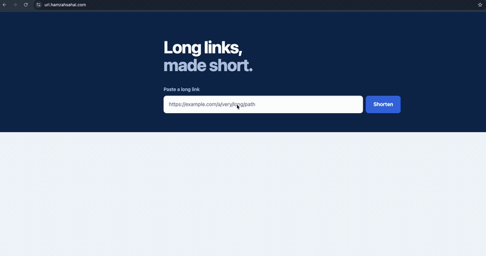

## Contents

- [Repo layout](#repo-layout)
- [Architecture](#architecture)
- [Key components](#key-components)
- [Deployment workflow](#deployment-workflow)
- [Decisions and trade-offs](#decisions-and-trade-offs)
- [Build practices](#build-practices)
- [Proof it works](#proof-it-works)
- [Troubleshooting](#troubleshooting)
- [Security practices](#security-practices)
- [Run it locally](#run-it-locally)
- [Deploy to AWS](#deploy-to-aws)
- [Teardown](#teardown)
- [What production would add](#what-production-would-add)

## Repo layout

```
.
├── app/
│   ├── src/
│   │   ├── main.py
│   │   ├── cache.py
│   │   ├── events.py
│   │   ├── db.py
│   │   └── static/index.html
│   ├── tests/
│   └── Dockerfile
├── services/
│   ├── worker/
│   │   ├── main.go
│   │   └── Dockerfile
│   └── dashboard/
│       ├── main.go
│       ├── index.html
│       └── Dockerfile
├── terraform/
│   ├── backend.tf
│   ├── provider.tf
│   ├── main.tf
│   ├── variables.tf
│   └── modules/
│       ├── network/
│       ├── alb/
│       ├── route53/
│       ├── ecs/
│       ├── database/
│       ├── cache/
│       ├── sqs/
│       ├── iam/
│       └── monitoring/
├── .github/workflows/
│   ├── docker-image.yml
│   ├── tf-plan.yml
│   ├── tf-apply.yml
│   └── tf-destroy.yml
├── docker-compose.yml
├── elasticmq.conf
└── .pre-commit-config.yaml
```

## Architecture

| Service | Language | What it does |
|---------|----------|--------------|
| **api** | Python (FastAPI) | `POST /shorten` saves the link to Postgres. `GET /{code}` checks Redis, then Postgres on a miss, sends a click event to SQS and redirects. Serves the shortener page at `/`. |
| **worker** | Go | Reads click events from SQS and saves each click to Postgres in one transaction. Failed messages go to a dead-letter queue after 5 attempts. |
| **dashboard** | Go | Shows totals, most-clicked links, recent clicks and an hourly chart per link, read from Postgres. |

**Request path:** Route 53 → ALB (HTTPS, with HTTP redirected) → WAF, attached to the ALB, checks the request → listener rules route by hostname. `url.hamzahsahal.com` goes to the API, `dashboard.url.hamzahsahal.com` to the dashboard, and anything else gets a 404.

**Network:** one VPC across two Availability Zones in eu-west-2, with three subnet tiers.

- **Public:** the ALB only.
- **App:** the ECS tasks (no public IPs) and the VPC endpoints.
- **Data:** RDS and Redis.

There is no NAT gateway. Tasks reach AWS through interface endpoints (ECR, CloudWatch Logs, SQS, Secrets Manager) and a free S3 gateway endpoint for image layers. SQS is a regional service outside the VPC, reached through its endpoint.

## Key components

| Component | What it does | Where |
|-----------|--------------|-------|
| **Compute** | One ECS cluster with three Fargate services on ARM64, two tasks each across two AZs | [`terraform/modules/ecs`](terraform/modules/ecs) |
| **Load balancer and WAF** | Routes each hostname to its own target group. Unknown hosts get a 404. WAF runs three AWS managed rule groups and a rate limit of 100 requests per 5 minutes per IP | [`terraform/modules/alb`](terraform/modules/alb) |
| **DNS and HTTPS** | Route 53 records and an ACM certificate for both hostnames. HTTP redirects to HTTPS | [`terraform/modules/route53`](terraform/modules/route53) |
| **Database** | RDS PostgreSQL 16, chosen for its aggregation queries. See [Decisions and trade-offs](#decisions-and-trade-offs) | [`terraform/modules/database`](terraform/modules/database) |
| **Cache** | ElastiCache Redis caches links for 24 hours. Falls back to Postgres if Redis is down | [`terraform/modules/cache`](terraform/modules/cache), [`app/src/cache.py`](app/src/cache.py) |
| **Queue** | SQS carries click events from the API to the worker. Dead-letter queue after 5 failed attempts | [`terraform/modules/sqs`](terraform/modules/sqs), [`services/worker`](services/worker) |
| **Network** | Private subnets with no public IPs. VPC endpoints instead of a NAT gateway. Security groups only allow traffic from the services that need it | [`terraform/modules/network`](terraform/modules/network) |
| **Secrets** | Terraform generates the database password and stores the connection string in Secrets Manager. ECS injects it at start-up | [`terraform/modules/database`](terraform/modules/database) |
| **IAM** | The execution role can only reach the three ECR repos, three log groups and one secret. Task roles only have the SQS actions each service needs. The dashboard has no task role | [`terraform/modules/iam`](terraform/modules/iam) |
| **Deployments** | API: ECS canary (10%, then 100%) with rollback on 5xx alarms or the circuit breaker. Worker and dashboard: rolling deploys with the circuit breaker | [`terraform/modules/ecs`](terraform/modules/ecs) |
| **CI/CD** | GitHub Actions with OIDC, no stored AWS keys. Images are tagged with the git SHA. Plan runs on every PR, and apply needs approval | [`.github/workflows`](.github/workflows) |
| **Security scanning** | Trivy fails the build on fixable critical vulnerabilities. Checkov and TFLint check the Terraform on every PR, and Checkov comments its results | [`.github/workflows`](.github/workflows) |
| **Pre-commit hooks** | Run on every commit: gitleaks, hadolint, `terraform fmt`, `validate` and TFLint, plus YAML, merge-conflict and large-file checks | [`.pre-commit-config.yaml`](.pre-commit-config.yaml) |
| **Monitoring and alerting** | CloudWatch logs for every service. Alarms for API 5xx errors, unhealthy targets, dead-letter messages and low RDS storage, emailed through SNS | [`terraform/modules/monitoring`](terraform/modules/monitoring) |
| **Terraform** | Nine modules called from one root. Remote state in S3 with state locking. `default_tags` on every resource | [`terraform`](terraform) |
| **Containers** | Multi-stage builds. The final image runs from a small base as a non-root user | [`app/Dockerfile`](app/Dockerfile), [`services/worker/Dockerfile`](services/worker/Dockerfile), [`services/dashboard/Dockerfile`](services/dashboard/Dockerfile) |

## Deployment workflow

Changes go through a pull request with automated checks. On merge, images are pushed to ECR tagged with the commit SHA, Terraform applies after a manual approval, and ECS rolls out the API as a canary and the other two services as rolling deployments.

**1. Pull request**

Every change starts on a feature branch. The PR runs checks for whatever changed:

- **App code:** all three images are built and scanned with Trivy. Fixable critical vulnerabilities fail the build. Nothing is pushed.
- **Terraform:** `terraform fmt -check`, TFLint, Checkov, `validate` and `plan`. Checkov posts its findings as a PR comment.

**2. Merge to main**

- The Docker workflow builds, scans and pushes the images to ECR, tagged with the commit SHA. It then writes the SHA to SSM Parameter Store.
- Terraform plan then runs on `main`. It also runs on its own when a merge only changes Terraform.

**3. Approval**

Terraform apply starts after a successful plan on `main` and waits for approval on the protected `prod` environment. The plan is reviewed before approving. Apply then deploys the exact commit that was planned, using the image tags from SSM.

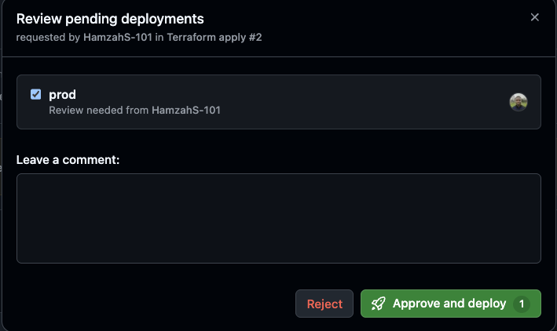

**4. Rollout**

The API uses ECS's native canary deployment, not CodeDeploy. ECS shifts traffic between two target groups itself, so there is no CodeDeploy application, deployment group or AppSpec file.

1. New tasks start in the alternate target group and must pass ALB health checks.
2. 10% of traffic moves to them for 5 minutes.
3. The other 90% moves over. The old tasks are kept for another 5 minutes.
4. The old tasks are stopped.

**A canary deployment in progress, with 10% of traffic on the new tasks:**

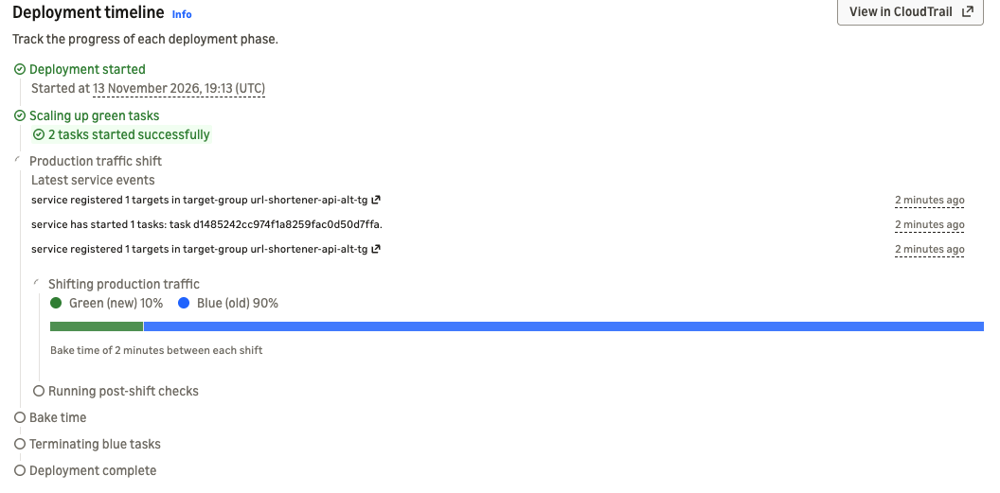

**The listener rule after the canary, with all traffic moved to the alternate target group:**

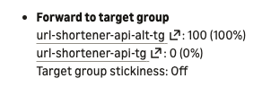

If either API 5xx alarm fires, ECS moves all traffic back to the old tasks. If new tasks fail to start or fail health checks, the circuit breaker rolls back.

<a name="alarm-rollback"></a>
**ECS rolling back a deployment because a 5xx alarm was active:**

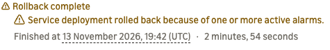

The worker and dashboard use rolling deploys. New tasks start next to the old ones, and old tasks only stop once the new ones are healthy. The circuit breaker rolls back a failed deploy.

**Before and after a canary deploy.** The only change was the button text, from **Shorten** to **Shrink it**.

Before:

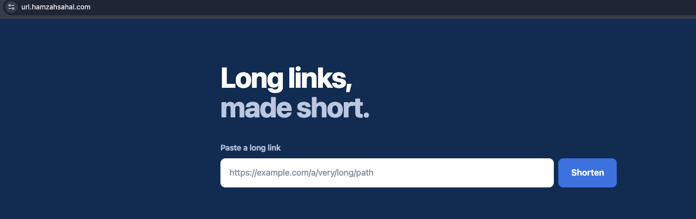

After:

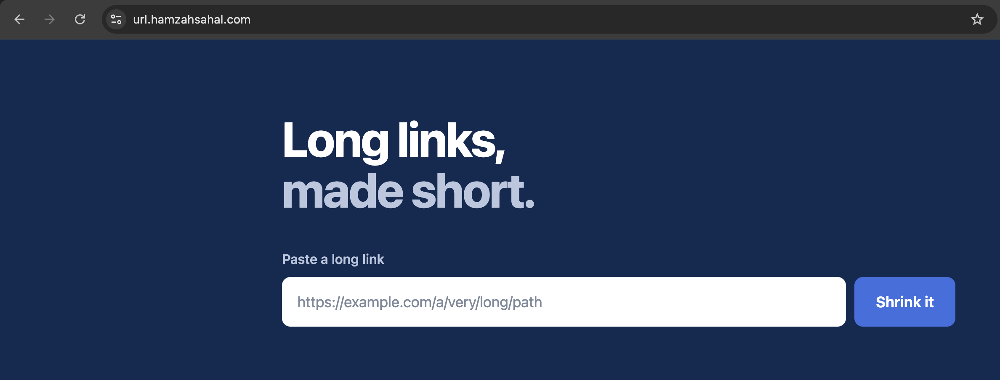

**Timing:** images are pushed about 4 minutes after the merge. After approval, the canary gets 10% of traffic within about 2 minutes, and the deploy finishes about 12 minutes later.

## Decisions and trade-offs

### RDS PostgreSQL, not DynamoDB

The dashboard groups and counts clicks: the most-clicked links, total clicks and clicks per hour. Postgres does each of those in a single query with `ORDER BY`, `SUM` and `GROUP BY`. DynamoDB looks items up by key and has no built-in way to group or sum them.

Trade-off: RDS has a fixed hourly cost and a single instance to look after, where DynamoDB on-demand would cost nothing when idle.

### SQS between the API and the worker

SQS decouples the API from the worker. The API publishes a click event and returns the redirect without waiting for the click to be saved, and the worker records it separately.

Trade-off: SQS delivers each message at least once. If the worker saves a click but fails before deleting the message, the message becomes visible again after 30 seconds and the click is counted twice. Clicks also show on the dashboard a few seconds late.

### Redis cache-aside on the redirect path

On a redirect the API checks Redis first. On a miss it reads Postgres and caches the result for 24 hours. If Redis errors, the API falls back to Postgres, so the cache can't take redirects down.

### VPC endpoints instead of a NAT gateway

Tasks have no internet route. They reach ECR, CloudWatch Logs, Secrets Manager and SQS through interface endpoints, and S3 through a free gateway endpoint. A compromised container can't call out to the internet.

Trade-off: five interface endpoints in two AZs cost more per hour than a single NAT gateway.

### ARM64 everywhere

Fargate on ARM64 is cheaper than x86. RDS and ElastiCache also run on ARM64 (`t4g`). Images build on GitHub's ARM runners without emulation, and match local development on Apple Silicon.

### Images tagged with the commit SHA, passed through SSM

Each image is tagged with its commit SHA, and ECR tags can't be overwritten. Every deploy creates a task definition pinned to one SHA, so any running task traces back to a commit. With `:latest`, the task definition never changes, so ECS never redeploys.

After a successful push, the Docker workflow writes the SHA to SSM and Terraform reads it. A Terraform-only commit has no images of its own, so SSM always holds the last tag that was built and pushed.

### Canary for the API, rolling for the others

The API handles all user traffic, so it gets the canary: a bad version only reaches 10% of requests before an alarm stops it. The worker has no load balancer, so it can't use a canary. The dashboard has few users, so a rolling deploy is enough.

### Database credentials in Secrets Manager

Terraform generates a random password and stores the full connection string in Secrets Manager. ECS passes it to the containers at start-up. Nothing is hardcoded.

Trade-off: the password is also in the Terraform state, in an encrypted private S3 bucket. There is no automatic rotation, and tasks only pick up a changed secret when they restart.

### Some resources live outside Terraform

The state bucket, ECR repositories, Route 53 hosted zone, image tag parameters and GitHub OIDC role are created once and kept. They survive every teardown, and `terraform destroy` can't delete the role it runs as.

### Single-AZ data, multi-AZ services

Each service runs two tasks across two AZs. RDS and Redis are single-AZ to save cost. If RDS goes down, cached links still redirect, new links can't be created, and clicks wait in the queue.

## Build practices

### Docker images

| Image | Final base | Size |
|-------|------------|------|
| api | `python:3.14-slim` | 322 MB |
| worker | `busybox` | 30 MB |
| dashboard | `distroless` | 23 MB |

- **Multi-stage builds:** dependencies are installed or compiled in a build stage, and the final image only gets the result.
- **Static Go binaries:** the worker and dashboard are compiled with `CGO_ENABLED=0`, so the final image needs no Go toolchain or C libraries. The dashboard runs on `distroless`, which has no shell at all.
- **Layer caching:** dependency files (`go.mod`, `go.sum`, `requirements.txt`) are copied and installed before the source code, so a code change doesn't reinstall dependencies.
- **Only what's needed:** each Dockerfile copies specific files rather than the whole folder, with a `.dockerignore` as well.
- **Smaller API image:** pip runs with `--no-cache-dir`, and pip itself is removed from the final image.
- **Non-root:** all three run as user `10001`.

The API is the largest because it carries the Python runtime, while the Go services are single compiled binaries.

### Terraform

- **Modules:** nine modules, each with its own `main.tf`, `variables.tf` and `outputs.tf`. The root `main.tf` connects them by passing one module's outputs into another.
- **No hardcoded values in modules:** every value comes in as a variable, with defaults set once in the root `variables.tf`.
- **Maps and `for_each` instead of repeated blocks:** maps in `locals` describe what to create, and one resource block loops over them. The security groups are 7 groups and 23 rules from 3 resource blocks. The 5 interface endpoints come from one block, and one map of services drives the target groups, listener rules, task definitions and log groups.
- **Tagging:** `default_tags` on the provider tags every resource with the project, environment, owner and `ManagedBy = terraform`.
- **State and versions:** remote state in S3 with locking, and pinned Terraform and provider versions.

## Proof it works

**All three services running two healthy tasks:**

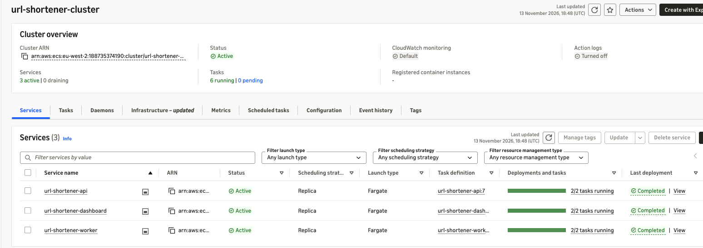

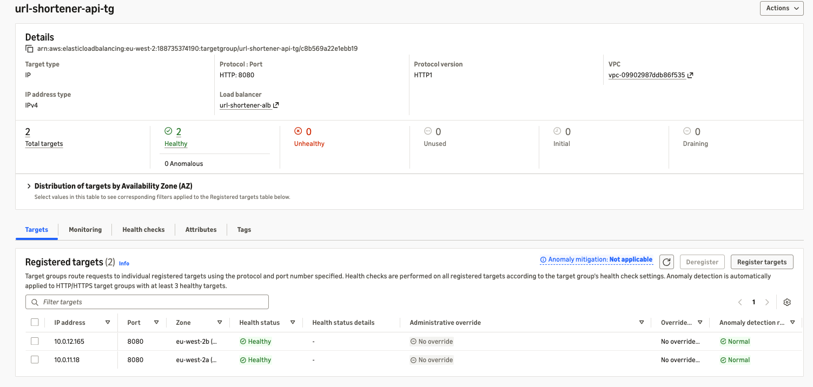

**Alarms in OK state:**

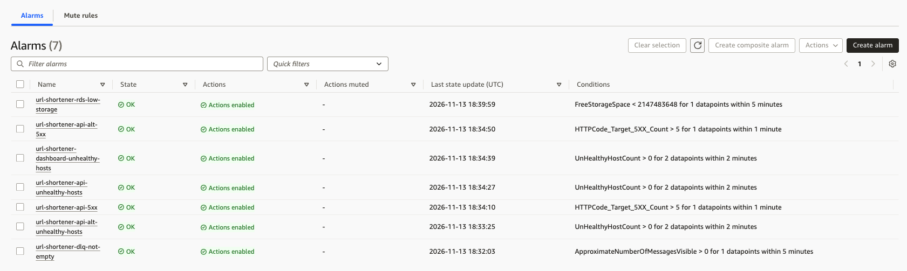

**VPC endpoints, no NAT gateway:**

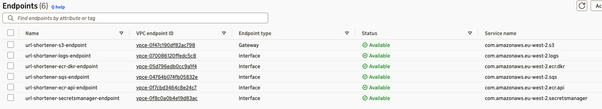

**Redis caching:** a new link clicked five times. The first click is a cache miss and reads Postgres. The next four are cache hits.

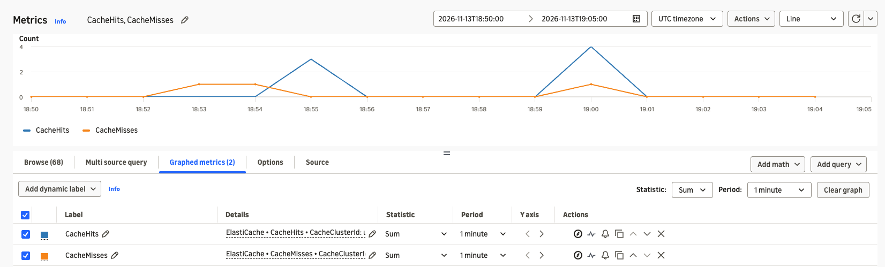

**WAF blocking:** requests with no User-Agent and requests with a Log4j-style header were blocked with a 403.

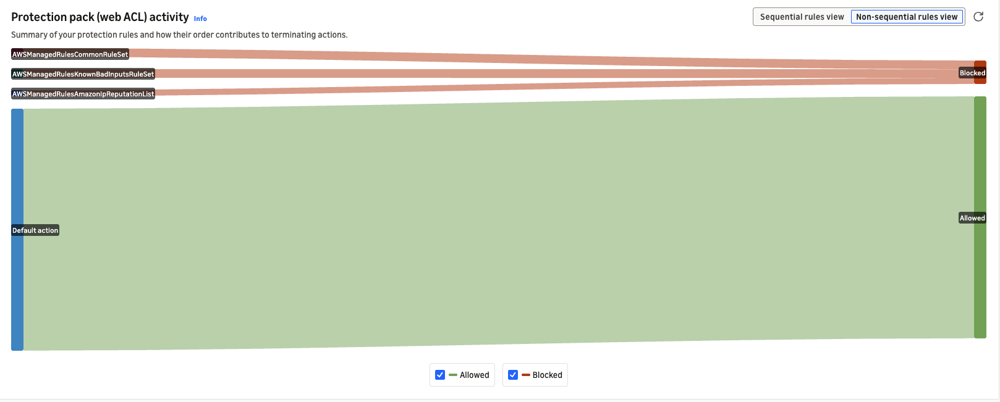

**Dashboard:**

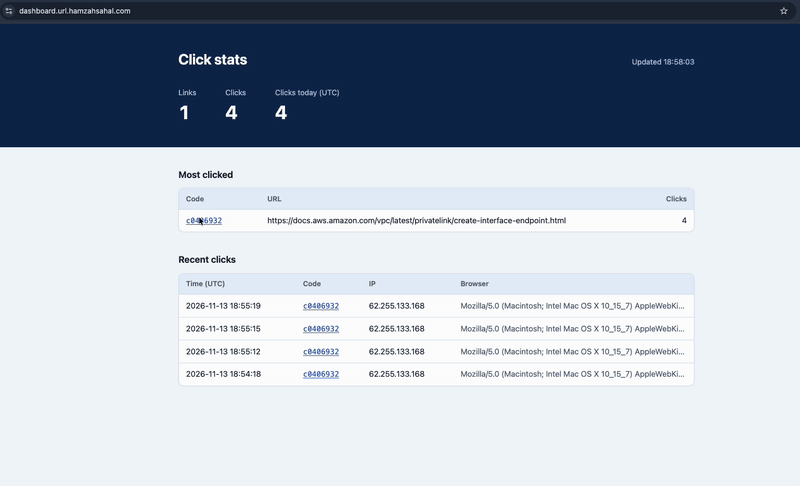

## Troubleshooting

### The canary didn't roll back a broken build

To test rollback, I deployed a build where every redirect returned a 500 but `/healthz` still passed, so only the 5xx alarm could catch it. The alarm fired about 3 minutes after the first error. The canary bake times were 2 and 1 minutes, so ECS finished the deployment 5 seconds before the alarm fired. Nothing rolled back.

**Fix:** bake times must be longer than the time an alarm takes to fire. Both are now 5 minutes. A later deployment showed the rollback working: the alarm fired during the bake and ECS rolled back ([see the rollback](#alarm-rollback)).

**The API 5xx alarm in ALARM state:**

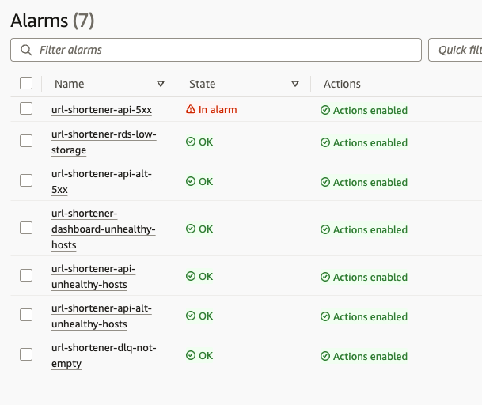

**The SNS email notification sent when the alarm fired:**

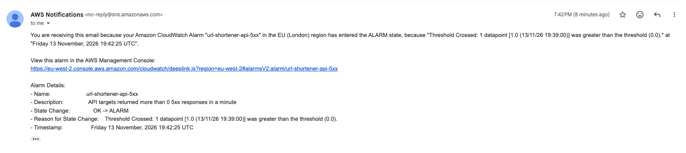

### Worker couldn't connect to SQS

The worker image is based on `busybox`, which has no CA certificates. The worker couldn't verify AWS's TLS certificate and every SQS call failed. Health checks passed, so it only showed up in an end-to-end test.

**Fix:** copy the CA bundle from the build stage into the final image.

### Tasks started before their secret existed

On the first apply, ECS started tasks before Terraform had written the database secret's value, so they failed to start.

**Fix:** the module output that passes the secret to ECS now depends on the secret value being written.

## Security practices

**Changes**

- Every change was made on a feature branch and merged through a pull request, with CI checks on each PR.
- Pre-commit hooks scan for secrets and lint Terraform and Dockerfiles before a commit is made. CI runs the same kind of checks, because hooks only run where they are installed and can be bypassed with `git commit --no-verify`.

**What the checks changed**

- hadolint flagged `pip install` without `--no-cache-dir` (DL3042), so the API image no longer keeps pip's download cache.
- TFLint requires every module to declare its Terraform and provider versions, so each module has a `versions.tf`.
- Trivy found high vulnerabilities in libraries bundled with pip, so pip is removed from the final API image. It also ruled out Alpine for the API, because every Python 3.14 Alpine image had a critical zlib vulnerability.

**Credentials**

- No long-lived AWS keys exist. GitHub Actions assumes a role through OIDC, and the role only trusts this repository.
- ECS tasks get temporary credentials from their task roles.
- Applying or destroying infrastructure needs approval on the protected `prod` environment.

**Secrets**

- The database connection string lives in Secrets Manager, never in code, images or environment files.
- The alert email is a GitHub secret, so it isn't in the public repo.
- `.gitignore` excludes Terraform state, `.tfvars` and `.env` files.

**Network**

- Only the ALB is public. Tasks, RDS and Redis have no public IPs.
- Security groups reference each other instead of IP ranges. For example, only the three services can reach RDS, and only the API can reach Redis.
- Task outbound traffic is limited to the VPC endpoints, S3 and the database. There is no route to the internet.
- The ALB uses a TLS 1.3 policy and drops invalid HTTP headers.

**Encryption**

- At rest: RDS, Redis, SQS and the Terraform state bucket.
- In transit: HTTPS to the ALB, TLS to Redis, and `sslmode=require` to Postgres.

**Containers and scanning**

- All images run as non-root on small base images.
- Trivy blocks images with fixable critical vulnerabilities from reaching ECR.
- Checkov findings were reviewed. Most were deliberate cost choices, such as single-AZ RDS. Two were false positives, where Checkov couldn't read settings that were in place.

## Run it locally

Clone the repo and start everything with Docker Compose:

```bash
git clone https://github.com/HamzahS-101/url-shortener-ecs.git
cd url-shortener-ecs
docker compose up --build
```

Open http://localhost:8080 to shorten and click links, and http://localhost:8081 to see the clicks on the dashboard.

`docker compose down` stops it. Add `-v` to also delete the database.

## Deploy to AWS

**One-time setup.** These are created once and kept between deploys:

1. An S3 bucket for Terraform state, with versioning, encryption and public access blocked.
2. Three ECR repositories: `url-shortener-api`, `url-shortener-worker` and `url-shortener-dashboard`, with immutable tags.
3. A Route 53 hosted zone for your domain.
4. A GitHub OIDC provider and an IAM role that trusts your repository.
5. In GitHub, a repository secret `ALERT_EMAIL` and an environment called `prod` with yourself as a required reviewer.

Then update the account-specific values: the account ID and role ARN in `.github/workflows/`, the bucket name in `terraform/backend.tf`, and `account_id`, `hosted_zone_name` and `domain_name` in `terraform/variables.tf`.

**Deploy:**

1. Run the **Docker build, scan and push to ECR** workflow. This pushes the first images and creates the image tag parameters in SSM.
2. Run the **Terraform plan** workflow, review the plan, then approve the **Terraform apply** run.
3. Confirm the SNS subscription email so alarms can reach you.

After that, every merge to `main` goes through the pipeline in [Deployment workflow](#deployment-workflow).

## Teardown

Run the **Terraform destroy** workflow and approve it. It removes everything Terraform created, about 105 resources, in around 10 minutes.

The one-time setup from [Deploy to AWS](#deploy-to-aws) stays in place: the state bucket, ECR repositories, hosted zone, SSM image tags and OIDC role. They cost very little to keep. To remove everything, delete those by hand after the destroy.

## What production would add

**Reliability**

- Multi-AZ RDS with longer backups, deletion protection and a final snapshot.
- A Redis replica in a second AZ with automatic failover.
- ECS auto scaling on CPU or request count, instead of a fixed two tasks.

**Deployments**

- Longer canary bake times (10 to 30 minutes).
- Alarms that only watch the canary's own errors, so errors from the old version can't trigger a rollback.
- Separate environments for dev and production.

**Security**

- Automatic rotation for the database secret, IAM authentication for RDS and an auth token for Redis.
- Customer-managed KMS keys for RDS, Redis, Secrets Manager and the logs, so key access and rotation are controlled directly.

**Observability**

- ALB access logs, WAF logs and VPC flow logs.
- Longer log retention and a CloudWatch dashboard.
- Alerts to Slack or an on-call tool instead of email.

**Application**

- Skip duplicate SQS messages so a click is never counted twice.
- Only rebuild the images whose code changed.
